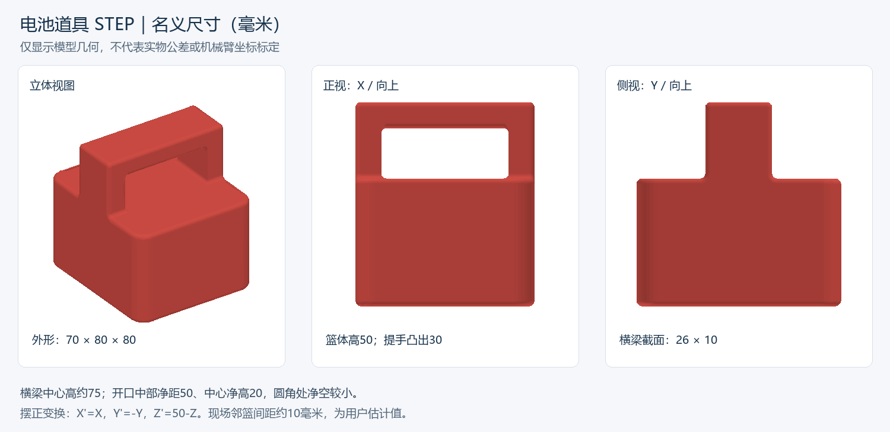

# 电池道具：模型测量与场地记录

日期：2026-10-11。以下是STEP名义几何尺寸及用户现场描述，不是实物尺寸验收或机械臂坐标标定。

## 来源与可复核结果

- 用户原文件：`D:\xwechat_files\wxid_cgjs7oxr0s5t22_86a0\msg\file\2026-10\电池道具.stp`。
- [项目内原样副本](../../reference/models/battery_prop_20261011/电池道具.stp)，124248字节；SHA256：`534c0892b173f1dc7e198648672784bfd221ecb35741f93dab98248399544a50`。
- STEP声明单位为毫米。OpenCascade读取为1个有效实体、64个面；实体检查通过。
- [结构化测量结果](measurements.json)、[复现脚本](../../scripts/analysis/inspect_battery_step.py)。包围盒来自实体边界，截面来自平面求交；未把网格预览精度当作测量精度。

## 尺寸

| 项目 | 名义尺寸（毫米） | 测量位置 / 含义 |
|---|---:|---|
| 整体外形 | 70 × 80 × 80 | CAD X、Y范围及整体高度 |
| 篮体中部水平截面 | 70 × 80 | CAD Z=25 |
| 篮体中心高度 | 50 | 中心竖线与实体表面交点 |
| 提手高出篮体 | 30 | 提手顶部至篮体顶面 |
| 提手横梁中部水平截面 | 70 × 26 | CAD Z=−25；两端/根部圆角不能套用此尺寸 |
| 横梁中心竖向厚度 | 10 | CAD Z=−30至−20 |
| 提手开口中部净宽 | 50 | CAD Z=−10截面的内侧间距 |
| 提手开口中心净高 | 20 | 中心竖线CAD Z=−20至0 |
| 横梁中心离底面高度 | 75 | 用于理解模型，不是机械臂Z目标 |

开口带圆角，不能把50×20理解为处处可通过的完整矩形。若夹指沿横梁短边闭合，可先以中部26毫米宽度作为几何参考；夹指厚度、接触高度、实物误差和夹紧量仍需实物核对，不能据此直接生成夹爪刻度。

原CAD包围盒：X=[−35,35]、Y=[−40,40]、Z=[−30,50]。预览将底面摆正为Z′=0，采用`X′=X，Y′=−Y，Z′=50−Z`。这只是显示变换，尚未求模型到机械臂基座的变换。



## 场地与后续使用

用户2026-10-11说明：四个篮体相邻摆放，场地障碍只有目标旁的另外三个篮体，间距约1厘米。红篮与T0位置固定。

记录为：数量4、邻近障碍3、估计间距10毫米；具体排列坐标、最小实测间距和重复摆放误差未测。尚未核对其余三个篮体是否与此模型完全同尺寸。当前不追加现场测量问答，后续结合路径审查和测试结果补充。

规划时须计入夹爪、腕部、连杆和夹持后篮体的运动包络。若带篮从相邻篮体上方通过，需要篮底高于障碍顶部并留经验证的余量；不能仅凭夹爪中心高于80毫米判断通过。实物质量、摩擦、夹持滑移与负载形变不由STEP给出。

## 复现

使用本工程Python，依赖目录为`.runtime_deps/cad_step`（已忽略，不提交库文件）；CAD依赖为`cadquery-ocp==8.0.1.1.0`、`cadquery-ocp-proxy==8.0.1.1.0`、`vtk==9.6.2`，渲染使用numpy、Pillow及Windows微软雅黑字体。

```powershell
& 'C:\Users\1\.cache\codex-runtimes\codex-primary-runtime\dependencies\python\python.exe' -X utf8 -B scripts/analysis/inspect_battery_step.py
```

运行只读取本地模型，生成JSON和PNG；不访问串口。脚本断言有效单实体、整体外形及中心表面交点，预览已经目视检查。
